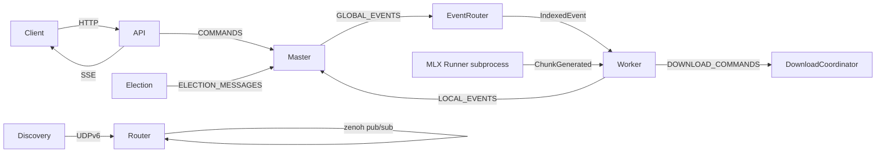

# EXO — Agent Context & Memory

> **Purpose:** This file is a fast-loading memory for AI coding agents working in this repository. Read this first, then dive into the detailed docs only when needed. It tells an agent what the project is, where things live, how to build/test, and what to watch out for.

---

## TL;DR (30-second read)

- **exo** = distributed AI inference system. Pools multiple devices (Apple Silicon Macs, Linux CUDA, CPU) into one cluster to run LLMs and image models locally.
- **Stack:** Python 3.13 (orchestration/API) + Rust (networking via forked zenoh + PyO3 bindings) + MLX (inference) + Svelte 5 dashboard.
- **Repo:** https://github.com/exo-explore/exo (Apache-2.0, by exo labs)
- **⚠️ Current branch:** `fix-memory-error` — **79 commits** ahead of main: 56+ ported upstream PRs + Wave 4 (#2129 `72cf86bb`, picker `d6fcef17`) + Wave 5 (torch lock `f48bdf86`, CUDA-node fallback `e6ec3e2c`, robust VRAM `2a9e15a2`) + Wave 6 (PR #2229 parts 1-4: token relay `f0e59802`, bandwidth placement `e18a8f0e`, link-speed ring `60f081e3`, prefix deadlock `e9011332`) + Linux UX commits (`ceccb23f` README, `40edf56a` setup script, `9d906d32`+`bba46caa` placement error) + hardening (`03dcb4e1` _networking_recv per-message guard) + dashboard (`db3736e2` Settings page, `9ea20961` message queue T24) + multi-GPU VRAM (`a082b091` sum across ALL GPUs).
- **Cluster (2026-08-07):** 2× Mac mini M4 Pro (this Mac + mini2, TB4-bonded RDMA) + **Linux box 10.2.0.16** (Proxmox VM, 2× RTX 5060 Ti 16GB, runs exo via MLX CUDA backend — verified 73.5 tok/s Llama 1B, 29 tok/s 3B, Qwen3.5-2B 17.6 tok/s; **152 tok/s Llama-3.2-3B after #2229 token relay**). ✅ **FIXED**: CUDA 12.8 toolchain (sm_120 JIT), torch on Linux, CUDA VRAM reporting. **Linux box SSH = passwordless `ssh tolinux`** (root@10.2.0.16, id_ed25519 key — no sshpass). Full playbook: `research/linux-nvidia-cuda-setup-guide.md`. ⚠️ `uv.lock` regen re-breaks torch markers (re-apply f48bdf86 patch); `uv sync` reverts mlx wheels (reinstall mlx_cuda_12 from /tmp/mlxwheel). Linux GPU verify/repair: `bash scripts/setup_linux_gpu.sh` (on the box).
- **Run it:** `cd dashboard && npm install && npm run build && cd .. && uv run exo` → API at `http://localhost:52415`.
- **Eject behavior (user-directed):** Eject = stop instance ONLY. Weights are NEVER auto-deleted (user request 2026-08-06). Manual deletion via Downloads page. **EjectButton now works** (two runtime bugs fixed: missing `svelte/transition` import + prop named `id` — verified live in browser, `DELETE /instance/<real-id>` → 200).
- **Build gotchas (2026-08-06):** `uv sync --extra mlx` REQUIRED before pyinstaller (mlx_lm is a git dep; plain sync prunes it → bundle ships without mlx_lm → models fail to load). `rm -rf dist/exo` before pyinstaller (dirty output dir blocks). Isolated test backends MUST use non-default ports (52416) or they squat 52415 and cause app exit-code-1 on launch.
- **Dev superpower:** `EXO_RUNTIME_DIR=/path/to/dist/exo` points the installed app at a fresh bundle (no xcodebuild); `EXO_DASHBOARD_DIR` overrides served dashboard. See `research/build-architecture-dev-loop.md`.
- **Message queueing (T24 BUILT `9ea20961`):** frontend FIFO — sends enqueue while generating, "N queued" chip, per-item remove, drain in finally. Backend already batches 8 concurrent (`EXO_MAX_CONCURRENT_REQUESTS=8`). Still pending: T25 reorder, T26 parallel drain, T27 sampling panel, T28 guided decoding. See `research/message-queueing-steering-research.md`.
- **Architecture:** every node runs the full stack (API + Master + Worker + Election + Router). Event sourcing keeps all nodes' state identical. A bully election picks the master. Rust handles discovery (UDPv6 multicast) + messaging (zenoh pub/sub).
- **Key ports:** API 52415 (TCP), zenoh 52414 (TCP), discovery 52413 (UDP).

---

## Repository Map (current, verified 2026-08-03)

```
src/exo/
├── main.py          # Node composition root, Args, entry point
├── api/             # FastAPI server + adapters (OpenAI/Claude/Ollama/Responses)
├── master/          # Master: command processor, event indexer, placement
├── worker/          # Worker: runner lifecycle, planning FSM, MLX engines
├── routing/         # Router (zenoh bridge), EventRouter, topics
├── download/        # DownloadCoordinator, HF shard downloaders
├── shared/          # apply(), election, topology, types, model cards
└── utils/           # channels, task_group, event_buffer, disk_event_log, info_gatherer
rust/
├── networking/      # zenoh fork wrapper: discovery.rs, swarm.rs, lib.rs
└── exo_rs/          # PyO3: NetworkingHandle, FromSwarm, Pidfile (+ exo_rs.pyi)
dashboard/           # Svelte 5 + TS frontend (build → dashboard/build/)
app/EXO/             # Native macOS SwiftUI app
tests/               # Integration tests (1/2/4-node, resilience, dashboard)
bench/               # exo_bench, exo_eval, tool-call eval
tools/src/exo_tools/ # client.py, cluster.py, harness.py (test/bench harness)
resources/           # Model cards (TOML) — inference_model_cards/, image_model_cards/
scripts/             # Utility scripts
docs/                # api.md (⚠️ outdated), benchmarks
packaging/           # PyInstaller spec, DMG
nix/                 # apple-sdk overlay, metal-toolchain, darwin-build-fixes.patch
```

---

## How the System Works (30-second version)

1. **Discovery:** Rust `discovery.rs` multicasts `Hello` on UDPv6 (`ff12::e0a1:de89`) every 1s; peers reply `WhatsUp` with their zenoh TCP port. Only the lower-zid node dials (avoids races).
2. **Election:** bully-style. Every node starts as its own master. `ElectionMessage(clock, seniority, commands_seen, node_id)` — highest wins. Re-triggered on peer connect/disconnect. Winner's `SessionId` becomes the cluster session.
3. **Event sourcing:** Master indexes events (sequential `idx`), applies to immutable `State`, persists to `DiskEventLog`, broadcasts `GlobalForwarderEvent` on `GLOBAL_EVENTS`. Every node's `EventRouter` resequences (NACKs gaps via `RequestEventLog`) and delivers `IndexedEvent`s to local consumers.
4. **Inference:** API request → `TextGeneration` command → master picks least-loaded instance → `TaskCreated` event → workers run FSM (`CreateRunner → DownloadModel → ConnectToGroup → LoadModel → StartWarmup → generate`) → MLX runner subprocess streams `ChunkGenerated` events → API streams SSE to client.

**Topics (src/exo/routing/topics.py):** `GLOBAL_EVENTS`, `LOCAL_EVENTS`, `COMMANDS`, `ELECTION_MESSAGES`, `CONNECTION_MESSAGES` (local only), `DOWNLOAD_COMMANDS`.

---

## Build & Run Commands

```bash
# Build dashboard (required before running)
cd dashboard && npm install && npm run build && cd ..

# Run exo
uv run exo                    # API at http://localhost:52415
uv run exo -v                 # verbose
uv run exo -m                 # force master
uv run exo --no-api           # headless
uv run exo --offline          # no downloads

# Tests
uv run pytest                 # excludes slow tests
uv run pytest -m ""           # all tests
uv run pytest src/exo/shared/tests/test_election.py

# Checks (MUST pass before commit)
uv run basedpyright && uv run ruff check && nix fmt && uv run pytest

# Rust
just rust-rebuild             # regenerate exo_rs.pyi + rebuild wheel

---

## Research Notes (agent-generated)

- `research/memory-bandwidth-ssd-prs.md` (2026-08-05) — PR survey for memory bandwidth, SSD-as-RAM (KV cache disk offload #1830/#2159), external storage (#1675/#1598), Thunderbolt multi-rail bonding (#2160/#2195), asymmetric tensor parallelism (#2064/#1821), Ring Attention (#2255), KV cache quantization (#2242/#1988), GPU VRAM reporting (#2216). Watch list included in doc.
cargo build                   # build workspace
cargo nextest run             # Rust tests

# Packaging
just package                  # PyInstaller
just build-app                # macOS app (rust-rebuild → sync-clean → package → xcodebuild)
```

---

## Key Conventions (from RULES.md)

- **Type-level discipline** — eliminate runtime try-catch/if via types.
- **Descriptive names** — no 3-letter acronyms, no non-standard contractions.
- **Pure functions** — same inputs → same outputs; side-effects only via injectable effect handlers.
- **Pydantic** — `frozen=True`, `strict=True`; inherit `UUID4` for UUIDs; idempotency tags = salted hash of persisted state.
- **Event sourcing** — `apply(state, IndexedEvent)` is the ONLY state mutator; strict ordering (`last_event_applied_idx == idx - 1`).
- **Strict typing** — basedpyright with `reportAny=error`.

---

## Gotchas & Traps (read before editing)

1. **`AGENTS.md` is OUTDATED** — it describes `src/exo/components/`, `src/exo/inference/`, `src/exo/model/`, `src/exo/tools/`, `src/exo/inspect/` which **do not exist**. Current layout: `api/`, `download/`, `master/`, `routing/`, `shared/`, `utils/`, `worker/`. Also `rust/system_custodian` does NOT exist.
2. **`docs/api.md` is outdated** — references `src/exo/master/api.py`; the API is `src/exo/api/main.py`.
3. **Node IDs are random per start** — `get_node_zid()` = `os.urandom(16).hex()`; keypair persistence is commented out (test `test_node_id_persistence.py` is skipped). Don't assume stable node identity.
4. **zenoh is forked** — `[patch.crates-io]` points all zenoh crates to `github.com/evanev7/zenoh` branch `exo`. Don't bump zenoh versions casually.
5. **Python is pinned to 3.13** — don't change `requires-python`.
6. **MLX is forked** — `mlx`/`mlx-lm` come from `rltakashige/mlx-jaccl-fix-small-recv` and `leo/deepseek-v4` branch. Image models need forked `mflux`.
7. **`EXO_BOOTSTRAP_PEERS` is broken** — don't rely on manual peer lists.
8. **No auth on the API** — never expose port 52415 to untrusted networks.
9. **Runner subprocesses** — the Worker spawns real MLX subprocesses via `RunnerSupervisor` with multiprocessing channels; `mp.set_start_method("spawn", force=True)` is required.
10. **Election resets everything** — on master change, `Node._elect_loop` rebuilds EventRouter/Worker/DownloadCoordinator and resets the API. Code touching these must handle session resets.
11. **`nix fmt` may change files** — run it and stage changes before committing.
12. **Dashboard must be built** before running exo or the UI won't be served.
13. **API requests pause during elections** — `API._send` blocks on `paused_ev` while an election with a newer clock is in progress.
14. **Image chunking** — images are sent as `SendInputChunk` commands in `EXO_MAX_CHUNK_SIZE` (512KB) chunks; the Worker assembles them by SHA-256 hash into `image_cache` before starting the task.
15. **Task completion hack** — `plan._pending_tasks` notes: "the task status should be set to completed by the LAST runner, it is currently set by the first — this is definitely a hack".
16. **Pydantic strict round-trip** — `DiskEventLog` serializes msgpack → JSON → `validate_json` because strict mode breaks `validate_python` round-trips. Keep this pattern if you touch event persistence.
17. **`State` is immutable + tagged** — `FrozenModel` (camelCase aliases, strict, extra=forbid) and `TaggedModel` (wrap serialization `{"ClassName": {...}}`). New types must follow this.
18. **Test envs** — unit tests use `FakeRunnerSupervisor` (no multiprocessing); slow distributed tests need a real GPT-OSS model download; `test_tokenizers.py` downloads tokenizer files only.
19. **`test_node_id_persistence` is skipped** because node-id keypair persistence is disabled — if you re-enable it, un-skip that test (it exercises concurrent subprocess reads of a shared keypair file).

---

## Where to Find Things

| Need | Look in |
|---|---|
| Message types (events/commands/tasks) | `src/exo/shared/types/` |
| State mutation rules | `src/exo/shared/apply.py` |
| Placement/sharding logic | `src/exo/master/placement.py`, `placement_utils.py` |
| Runner lifecycle FSM | `src/exo/worker/plan.py` |
| MLX engine | `src/exo/worker/engines/mlx/` |
| Image/diffusion engine | `src/exo/worker/engines/image/` (FLUX/Qwen via forked mflux, PipeFusion) |
| Disaggregated prefill/decode | `src/exo/worker/disaggregated/` + `engines/mlx/disaggregated/` |
| Networking (Rust) | `rust/networking/src/` |
| Python↔Rust boundary | `rust/exo_rs/src/networking.rs` + `exo_rs.pyi` |
| API endpoints (full route list) | `src/exo/api/main.py` `_setup_routes()` |
| Model cards format | `resources/inference_model_cards/*.toml` |
| Test harness | `tools/src/exo_tools/harness.py` |
| Env vars / paths | `src/exo/shared/constants.py` |
| Dashboard state | `dashboard/src/lib/stores/app.svelte.ts` |
| Trace instrumentation | `src/exo/shared/tracing.py` (Chrome trace format) |
| Power/bench sampling | `src/exo/utils/power_sampler.py` |
| Hardware profiling | `src/exo/utils/info_gatherer/` |
| Per-model output parsing | `src/exo/worker/runner/llm_inference/model_output_parsers.py` (GPT-OSS, DeepSeek DSML, thinking models) |

---

## Documentation Index (this folder)

| File | Contents |
|---|---|
| `PROJECT-OVERVIEW.md` | Purpose, features, high-level how-it-works, quick start |
| `ARCHITECTURE.md` | Deep dive: every module, class, function, message flow |
| `FILE-INVENTORY.md` | Exhaustive file-by-file map of the entire repository |
| `GIT-HISTORY-AND-UPSTREAM.md` | **Current branch work**: `fix-memory-error` commits, 5 ported PRs (#2159/#2160/#2242/#2251/#1990) with URLs, uncommitted `POST /peers` feature, upstream dependency URLs |
| `API-AND-USAGE.md` | REST API reference, dashboard, CLI, code examples with expected output |
| `DEPENDENCIES.md` | Full dependency inventory (Python, Rust, JS, Nix, tooling) |
| `KNOWN-ISSUES-AND-ROADMAP.md` | Known issues, platform limits, future work, testing status |
| `AGENT-CONTEXT.md` | This file — fast agent memory |

---

## Quick Reference: Message Flow Diagram

