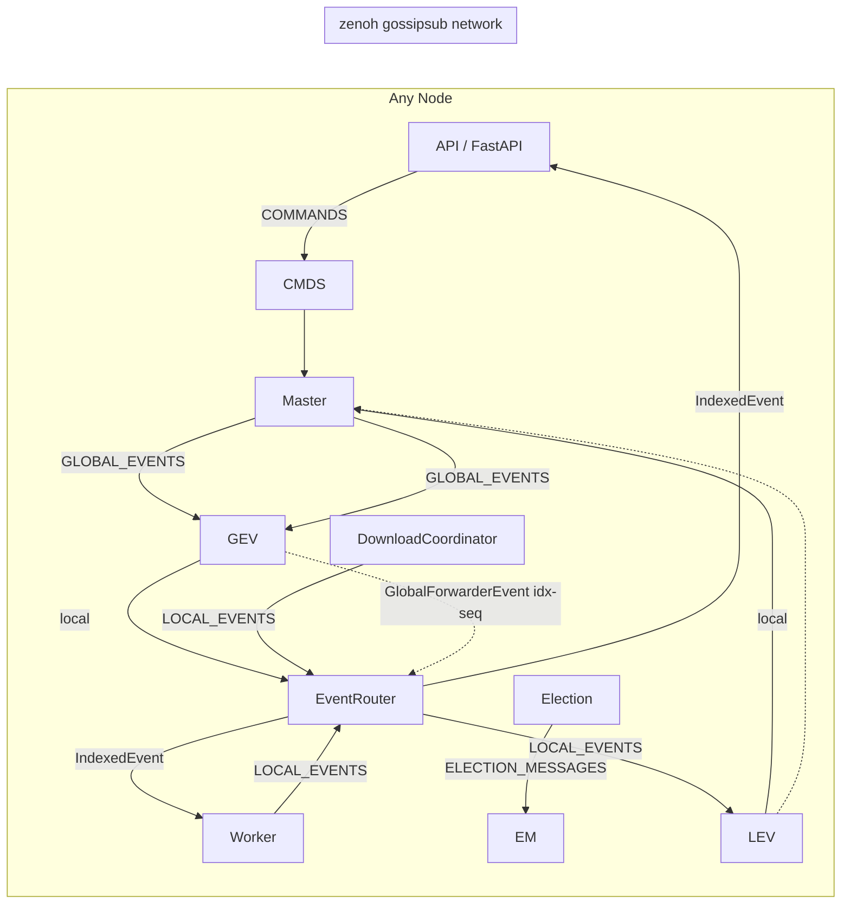

# EXO — Project Overview

> **Repository:** https://github.com/exo-explore/exo
> **License:** Apache-2.0
> **Maintained by:** exo labs ([X/Twitter](https://x.com/exolabs), [Discord](https://discord.gg/TJ4P57arEm))
> **Version (as documented):** 0.3.70 (Python package), Rust workspace 0.0.1
> **Documentation date:** 2026-08-03

---

## 1. What Is exo?

**exo is a distributed AI inference system that connects multiple devices into a single AI cluster.** It lets you run large language models (LLMs) and image models across many machines — including Apple Silicon Macs, Linux machines with CUDA GPUs, and CPU-only devices — as if they were one giant computer.

The core pitch: **"Run frontier AI locally."** Instead of renting cloud GPUs, exo pools the memory and compute of devices you already own. Not only can it run models *larger* than would fit on any single device, but with day-0 support for **RDMA over Thunderbolt**, models can actually run *faster* as you add more devices.

### Key facts

| Aspect | Detail |
|---|---|
| **Inference backend** | [MLX](https://github.com/ml-explore/mlx) (Apple's array framework) + [MLX distributed](https://ml-explore.github.io/mlx/build/html/usage/distributed.html) for cross-device communication |
| **Networking** | Custom Rust layer built on a **forked zenoh** (pub/sub + gossip scouting) with custom UDPv6 multicast peer discovery |
| **Language split** | Python (orchestration, API, event sourcing) + Rust (networking, PyO3 bindings, PID file locking) |
| **API surface** | OpenAI Chat Completions, OpenAI Responses, Anthropic Messages, Ollama — plus a native REST API and a Svelte dashboard |
| **Default ports** | API: `52415` (TCP), zenoh: `52414` (TCP), discovery: `52413` (UDP) |
| **Python version** | Pinned to `==3.13.*` |
| **Platforms** | Tier 1: Apple Silicon macOS (M3 Ultra, M4 Pro, M5, M4 Max). Planned: Linux CUDA (DGX Spark), Linux CPU, Vulkan, Windows |

---

## 2. Purpose

exo exists to solve three problems:

1. **Model size limits** — frontier models (DeepSeek v3.1 671B, Qwen3-235B, Kimi K2) don't fit on one device. exo shards them across a cluster of devices.
2. **Cost** — running models locally on hardware you own is dramatically cheaper than cloud GPU rental.
3. **Performance scaling** — with RDMA over Thunderbolt 5, adding devices *reduces* latency (up to 99% reduction between devices), so clusters get faster, not just bigger.

The project is designed around **zero-configuration**: devices running exo automatically discover each other on the local network, elect a master, and form a cluster with no manual setup.

---

## 3. Main Features

### 3.1 Automatic Device Discovery
Devices running exo automatically find each other via a custom **UDPv6 multicast protocol** (namespace-isolated with a blake3 hash). No manual configuration, no central server. See `rust/networking/src/discovery.rs`.

### 3.2 RDMA over Thunderbolt
Day-0 support for RDMA over Thunderbolt 5, enabling ~99% latency reduction between devices. The system detects Thunderbolt bridges, RDMA controllers, and prefers RDMA-enabled links for placement. See `src/exo/utils/info_gatherer/` and `src/exo/shared/types/profiling.py`.

### 3.3 Topology-Aware Auto-Parallelism
exo builds a realtime graph of your device topology (nodes + connection types + bandwidth) and automatically figures out the best way to split a model across devices. Placement considers:
- Available memory per node
- Network latency/bandwidth between links
- Backend support (MLX Metal / CUDA / CPU)
- RDMA availability
- Sharding strategy constraints

See `src/exo/master/placement.py` and `src/exo/master/placement_utils.py`.

### 3.4 Multiple Sharding Strategies
| Strategy | How it splits | When |
|---|---|---|
| **Pipeline** | Layers split across nodes (proportional to RAM) | Default, general purpose |
| **Tensor** | Heads + MoE experts split across nodes | Up to 1.8× speedup on 2 devices, 3.2× on 4 |
| **CFG** | Classifier-free-guidance parallel | Image models |

### 3.5 Multiple API Compatibility
- **OpenAI Chat Completions** — `/v1/chat/completions`
- **OpenAI Responses** — `/v1/responses`
- **Anthropic Messages** — `/v1/messages`
- **Ollama** — `/ollama/api/chat`, `/ollama/api/generate`, `/ollama/api/tags`, etc.

Use your existing tools and clients (LangChain, Open WebUI, etc.) pointed at `http://localhost:52415`.

### 3.6 Custom Model Support
Load any HuggingFace model via model cards (TOML files in `resources/inference_model_cards/` and `resources/image_model_cards/`), or add custom models through the API/dashboard.

### 3.7 Image Generation & Editing
FLUX.1 (incl. Kontext, Krea, schnell) and Qwen-Image models via a forked `mflux`, with image editing support (Qwen-Image-Edit).

### 3.8 Disaggregated Prefill/Decode
Optional (`ENABLE_DISAGGREGATION=1`) split of prefill and decode across different nodes, with KV-cache transfer over TCP (msgpack + zstandard protocol).

### 3.9 Continuous Batching & KV Prefix Caching
- `BatchGenerator` with continuous batching (`EXO_MAX_CONCURRENT_REQUESTS`)
- `KVPrefixCache` for reusing KV cache across requests with shared prefixes

### 3.10 Built-in Dashboard
Svelte 5 + TypeScript dashboard served at `http://localhost:52415` with:
- Live topology graph (D3)
- Chat interface (streaming, markdown, KaTeX, code highlighting, PDF/image attachments)
- Model picker with HuggingFace search
- Downloads manager
- Traces viewer (per-task inference traces)
- Instance management (place/delete, placement previews)
- Prefill/decode disaggregation controls
- Integrations page

### 3.11 macOS App
A native SwiftUI app (`app/EXO/`) that wraps the exo process: menu bar control, cluster state monitoring, Thunderbolt bridge detection, Sparkle auto-updates, bug reporting.

### 3.12 Event-Sourced Cluster State
All cluster state is derived from an ordered, disk-persisted event log. Every node applies the same events to an immutable `State` object — guaranteeing consistency without a central database.

### 3.13 Supported Model Families (built-in cards)
~150 inference model cards + ~18 image cards in `resources/`:
- **Text (inference_model_cards):** Llama 3.1/3.2/3.3/3.4, Qwen3 (0.6B–235B), Qwen3.5 (2B–397B), Qwen3.6, Qwen3-Next, Qwen3-Coder (incl. 480B, Next), Qwen3-VL, DeepSeek V3.1/V3.2/V4 (incl. Flash/Pro), GLM 4.5-Air/4.7 (Flash variants)/5/5.1, Kimi K2 (Instruct/Thinking)/K2.5/K2.6/K2.7-Code, MiniMax M2.1/M2.5/M2.7, GPT-OSS (20B/120B), NVIDIA Nemotron (3-Nano-30B, Nano-9B-v2, 70B), Gemma 4 (e2b/e4b/26b/31b), Step 3.5 Flash, Moonshot Kimi-K2.6
- **Image (image_model_cards):** FLUX.1-dev/Kontext/Krea/schnell (4/8-bit), Qwen-Image, Qwen-Image-Edit-2509

### 3.14 Model Card Format (TOML)
```toml
model_id = "mlx-community/Llama-3.2-1B-Instruct-4bit"
n_layers = 16
hidden_size = 2048
num_key_value_heads = 8
supports_tensor = true
tasks = ["TextGeneration"]
family = "llama"
quantization = "4bit"
base_model = "Llama 3.2 1B"
capabilities = ["text"]
context_length = 131072
backends = ["MlxMetal", "MlxCuda", "MlxCpu"]
[storage_size]
in_bytes = 729808896
[sampling_defaults]
temperature = 0.6
top_p = 0.9
```

### 3.15 Reasoning & Thinking Support
- `ReasoningEffort` (none/minimal/low/medium/high/xhigh) + `enable_thinking` resolution
- `ReasoningDialect` per model: `none`, `post_last_user`, `suffix`, `channel`, `tool_conditional` (drives server-side encoder + integration configs)
- Thinking-token extraction for DeepSeek (`<think>`), GPT-OSS (`<|channel|>`/`<|message|>`/`<|call|>`), GLM (`<arg_key>`/`<arg_value>`), generic thinking models
- DSML tool-call encoding for DeepSeek V3.2/V4 (vendor code in `engines/mlx/vendor/`)

---

## 4. How It Works (High Level)



**The core loop:**

1. **Discovery** — nodes find each other via UDPv6 multicast (`Hello`/`WhatsUp` protocol), then establish zenoh TCP links (only the lower-zid node dials to avoid races).
2. **Election** — a bully-style algorithm elects a master. Every node starts as its own master; the highest `(clock, seniority, commands_seen, node_id)` wins. Elections re-trigger on peer connect/disconnect.
3. **Event sourcing** — the master indexes events (assigns sequential `idx`), applies them to its `State`, persists to a `DiskEventLog`, and broadcasts `GlobalForwarderEvent`s on `GLOBAL_EVENTS`. Every node's `EventRouter` resequences events (NACKing gaps via `RequestEventLog`) and delivers `IndexedEvent`s to local consumers (Worker, API, Master).
4. **Inference** — a client request hits the API → becomes a `TextGeneration` command → master picks the least-loaded instance → `TaskCreated` event → workers plan runner lifecycle (`CreateRunner → DownloadModel → ConnectToGroup → LoadModel → StartWarmup → generate`) → the MLX runner subprocess streams `ChunkGenerated` events back through the event pipeline → API streams SSE to the client.

---

## 5. Repository Layout

```
exo/
├── src/exo/            # Python backend (the Node: API, Master, Worker, Election, Router)
│   ├── main.py         # Entry point, Args, Node composition root
│   ├── api/            # FastAPI server + adapters (OpenAI/Claude/Ollama/Responses)
│   ├── master/         # Master: command processor, event indexer, placement
│   ├── worker/         # Worker: runner lifecycle, planning FSM, MLX engines
│   ├── routing/        # Router (zenoh bridge), EventRouter, topics
│   ├── download/       # DownloadCoordinator, shard downloaders (HF)
│   ├── shared/         # apply(), election, topology, types (events/commands/tasks), model cards
│   └── utils/          # channels, task_group, event_buffer, disk_event_log, info_gatherer
├── rust/
│   ├── networking/     # zenoh fork wrapper: discovery, swarm, session
│   └── exo_rs/         # PyO3 bindings: NetworkingHandle, FromSwarm, Pidfile
├── dashboard/          # Svelte 5 + TS frontend
├── app/EXO/            # Native macOS SwiftUI app
├── tests/              # Integration tests (1/2/4-node, resilience, dashboard)
├── bench/              # exo_bench, exo_eval, tool-call eval
├── tools/              # exo_tools: client, cluster, harness (used by tests/bench)
├── resources/          # Model cards (TOML) for inference + image models
├── scripts/            # Utility scripts (download_model_to_cluster.py, etc.)
├── docs/               # api.md, benchmarks
├── packaging/          # PyInstaller spec, DMG creation
└── nix/                # Nix build config (apple-sdk overlay, metal toolchain)
```

---

## 6. Quick Start

### From source (macOS)

```bash
# Prerequisites: Xcode, Homebrew, uv, node
brew install uv
curl --proto '=https' --tlsv2 -sSf https://sh.rustup.rs | sh

git clone https://github.com/exo-explore/exo.git
cd exo

# Build the dashboard (required before running)
cd dashboard && npm install && npm run build && cd ..

# Run exo (starts master + worker, API at http://localhost:52415)
uv run exo
```

### With Nix

```bash
nix run .#exo
```

### Homebrew cask

```bash
brew install --cask exo
```

### macOS App

Build with `just build-app` (rust-rebuild → sync-clean → package → xcodebuild), or use the packaged DMG.

---

## 7. Where to Go Next

- **Architecture deep dive:** `promptsANDplans/ARCHITECTURE.md`
- **Exhaustive file-by-file map:** `promptsANDplans/FILE-INVENTORY.md`
- **API reference & usage examples:** `promptsANDplans/API-AND-USAGE.md`
- **Dependencies & frameworks:** `promptsANDplans/DEPENDENCIES.md`
- **Known issues & roadmap:** `promptsANDplans/KNOWN-ISSUES-AND-ROADMAP.md`
- **Agent context / memory:** `promptsANDplans/AGENT-CONTEXT.md`

## 8. Language & File Statistics

| Language | Role | Locations |
|---|---|---|
| Python (~90k LOC) | Orchestration, API, event sourcing, MLX engines, downloads | `src/exo/`, `tools/`, `bench/`, `tests/` |
| Rust | Networking (zenoh fork wrapper, discovery), PyO3 bindings, pidfile | `rust/` |
| TypeScript/Svelte | Dashboard | `dashboard/` |
| Swift | Native macOS menu-bar app | `app/EXO/` |
| TOML | Model cards, bench configs | `resources/`, `bench/` |
| Nix | Reproducible builds | `flake.nix`, `nix/`, `parts.nix` |
| Bash | Packaging, uninstaller | `packaging/`, `app/EXO/` |